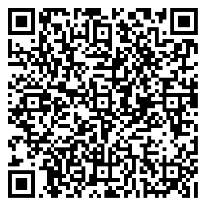
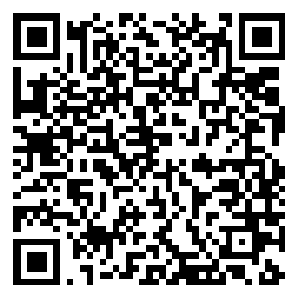
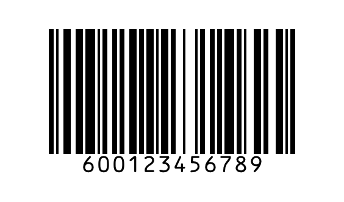
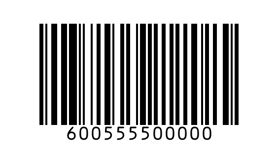

# 시연용 송장 라벨

PC 모니터에 이 페이지를 띄우거나 인쇄한 뒤 앱의 스캔 화면으로 찍으세요.

| 라벨 | 형식 | 결과 |
|---|---|---|
|  | QR (JSON) — 홍길동 | 정상 전달 |
|  | QR (구분자) — 이서연 | 정상 전달 |
|  | Code128 운송장번호 → 모의 DB 조회 (김민수) | 정상 전달 |
|  | Code128 — 박미응답 (끝자리 0000) | 미응답 → MMS 대체 발송 |
